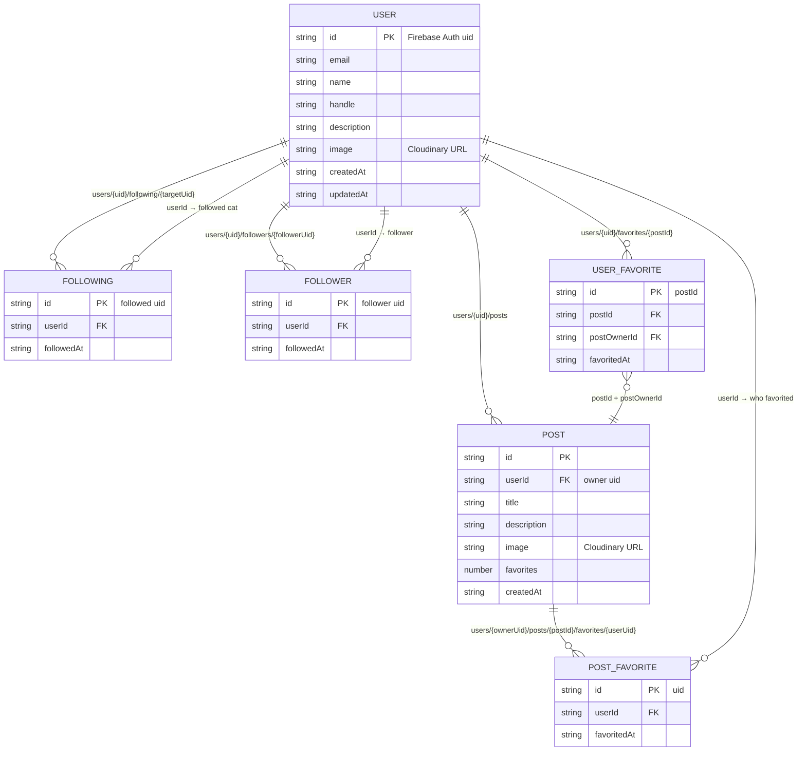

# Catspace

Welcome to Catspace! A social network where cats are the stars. 😺✨

Create a profile for your cat, share their latest adventures, follow other cats, and favorite the posts that deserve your attention. It's basically Myspace, but exclusively for cats (and the humans running their accounts).

### Core Features

- Create and customize cat profiles
- Share photos and updates
- Follow other cats
- Favorite posts
- Discover new cats and posts
- Personalized social feed
- English and French support

Visit the live site at [catspace.megankrenbrink.com](https://catspace.megankrenbrink.com).

Enjoy exploring Catspace!

— Megan Krenbrink

---

## Getting Started

### Prerequisites

- Node.js 24.15+
- npm

### Installation

```bash
# Install dependencies
npm install

# Start development server
npm start

# Build for production
ng build

# Run unit tests (Vitest)
ng test

# Run end-to-end tests (Playwright)
npm run e2e

# Start storybook server
npm run storybook
```

Open [http://localhost:4200](http://localhost:4200) to view the app.
Open [http://localhost:6006](http://localhost:6006) to view storybook.

### Environment Setup

Requires a Firebase project. Put your API key in `src/environments/firebase-key.ts` (gitignored).

## Tech Stack

- **Angular 22** with **TypeScript**
- **Tailwind CSS** for styling
- **Angular Material** for UI components
- **Firebase Auth + Firestore** for authentication and data
- **Cloudinary** for image uploads
- **@ngx-translate** for i18n (English, French)
- **Storybook** for UI development
- **Vitest** for unit tests, **Playwright** for end-to-end tests
- **GitHub Actions** for CI

## Lighthouse

|         | Performance | Accessibility | Best Practices | SEO |
| ------- | ----------- | ------------- | -------------- | --- |
| Mobile  | 73          | 100           | 100            | 100 |
| Desktop | 98          | 100           | 100            | 100 |

Zero layout shift (CLS 0). Measured October 2026.

## Project Structure

```
src/
├── app/                # Application code
│   ├── components/     # Feature components
│   │   └── ui/         # UI primitives
│   ├── pages/          # Routed pages
│   ├── services/       # Services, models and mocks
│   └── shared/         # Guards, state, pipes, utilities
├── assets/             # Images and i18n files
├── stories/            # Storybook stories
├── styles/             # Global and theme styles
└── environments/       # Environment config
```

## Data Model

Firestore collections and subcollections:


